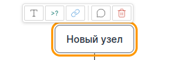

# Что умеет и зачем нужно
**iStruct** - приложение, которое позволяет структурировать информацию (преимущественно, текстовую) в виде совокупности "диаграмма связей + заметки".  Диаграмму связей также часто называют [Mind Map](https://ru.wikipedia.org/wiki/Диаграмма_связей) - она позволяет графически отображать связи между различными понятиями.

Я начал делать его как вспомогательный инструмент для изучения новых тем, отсюда "учебная" тематика: возможности отмечать узлы диаграммы  как "пройденные" и запускать тесты.

Основные сценарии использования выглядят так:

 - **структурирование знаний по теме**. Например, для конспектирования лекции. Создается новая диаграмма, к ней вручную добавляются узлы, соответствующие каким-то понятиям. К узлам при необходимости добавляются заметки. По мере развития такая схема становится все более "развесистой", но в тоже время в ней относительно просто ориентироваться и находить нужную информацию. Дальше такую схему можно сохранить в файл и, например, кому-то передать.
 - **то же, но с использованием нейронной сети**. Нужен чатбот (условная "Алиса"), ей передается файл с описанием формата схемы и запрос "Сделай мне схему по такой-то теме в данной формате". Полученный код из окна чатбота сохраняется в файл и загружается в iStruct. Полученная схема может, помимо диаграммы и заметок, содержать тесты - в настоящее время это единственный способ добавления тестов в приложении. На выходе получается что-то вроде миниатюрного учебного курса: теория + тесты.
 - **как средство борьбы с "проблемой белого листа"** - когда нужно что-то написать, но непонятно, с чего начинать. Можно набросать "скелет"  как узлы диаграммы связей и постепенно наращивать "мясо" в виде текста заметок. Это позволяет писать текст не "сверху вниз", как в редакторе, а более спонтанным образом, при этом наблюдая его структуру. Я , например, пишу в нем некоторые тексты для данного сайта

Таким образом, **iStruct** имеет черты редактора Mind Map, приложения для ведения заметок и [структурного редактора текста](https://ru.wikipedia.org/wiki/Структурный_редактор). Выбор конкретного способа применения остается за вами.

# Работа со схемой
Приложение позволяет организовывать информацию в виде иерархии узлов. Корневой узел один, дочерние "растут" от него в четырех направлениях.\
Существует несколько типов узлов:
 -  текстовый узел.  Используется чаще всего
 -  ссылка. Хранит ссылку на страницу в Интернет
 -  тест. Используется для хранения тестов.


Можно создавать узлы всех типов, редактировать - все, кроме тестового. "Наполнение" тестового узла данными производится с помощью LLM. 

Также к каждому узлу можно добавлять текстовый комментарий ()

\
Панель, которая появляется при наведении мыши на узел, позволяет:
 - создать дочерний узел одного из трех типов
 - добавить комментарий
 - удалить текущий узел.\
Также к узлам можно прикреплять заметки — для этого используется боковая панель ().

# Горячие клавиши
**Масштаб**

***Alt + <плюс>*** увеличить масштаб

***Alt + <минус>*** уменьшить масштаб

***Alt + 0*** масштаб по умолчанию

**Панели**

***Alt + 1*** показать/скрыть левую панель (справку)

***Alt + 2*** показать/скрыть правую панель (тесты/заметки)

***Alt + 3*** показать/скрыть меню "ФАЙЛ"

**Использование мыши**

***Ctrl + <щелчок по ссылке>*** переход по ссылке

***Ctrl + <перемещение узла поверх другого>*** привязка к другому родительскому узлу

***Ctrl + <колесо мыши>*** изменение масштаба

# Работа с нейросетью в режиме чата
Самый простой способ начать работать с программой - использовать чат какой-либо нейронной сети. Нужно прикрепить к сообщению чата файл описания формата DATA_FORMAT.md, после чего "попросить" нейросеть создать схему с нужными вам данными. Например для создания схемы изучения регулярных выражений языка Python можно написать:
```
Я передаю тебе описание формата данных Mind Map. Реализуй схему для изучения регулярных выражений с примерами на языке Python 3. Проставь ссылки на источники. Не забудь тесты.
```
После чего дождаться завершения вывода нейросети, скопировать сгенерированные JSON-данные в файл и загрузить его с помощью кнопки\
"Загрузить из файла".\
Если всё прошло успешно, схема откроется для редактирования. Для запуска тестов (если такие есть), нужно выделить узел с тестом, открыть боковую панель, после чего нажать на кнопку "Начать тест". \
```
Внимание!
Нейросети могут и любят галлюцинировать. Вполне вероятно, что созданная схема будет содержать ошибки. Используйте её как "отправную точку" для работы.
```
# Контакты
Если вам интересно следить за развитием и новостями iStruct, есть вопросы или предложения - есть [сообщество Вконтакте](https://vk.ru/club241372985).

Код приложения [лежит на github ](https://github.com/taurus256/istruct), и лицензирован под Creative Commons Attribution (CC BY).
